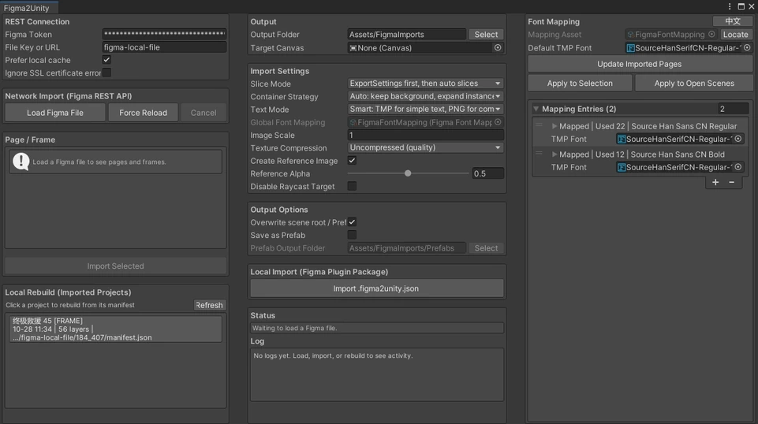
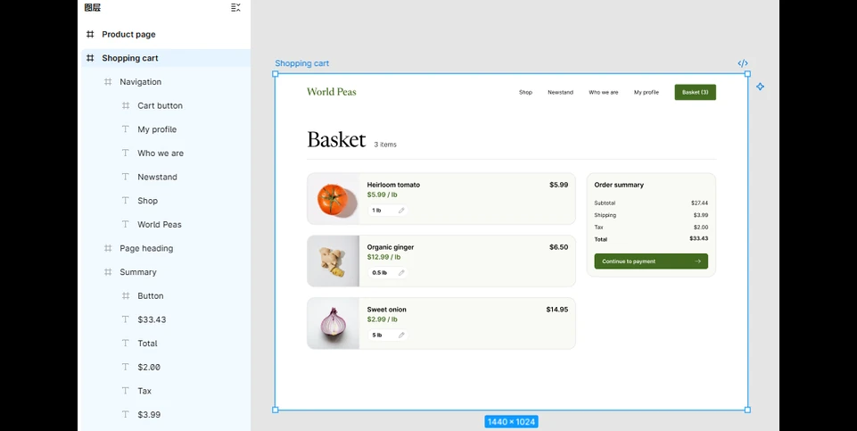

[中文](README.zh-CN.md) | English

# 🚀 Figma2Unity

Import Figma frames into a Unity Canvas with reference images, sliced sprites, TextMeshPro text, font mapping, manifests, and prefabs.

> Requires UGUI and TextMeshPro.

## ✨ Features

- ⭐ **Two import paths**: Figma plugin offline package (recommended) / Figma REST API
- 🖼️ **Visual fidelity**: full reference image + pixel-calibrated slices, clipping based on `clipsContent`
- 🔤 **Text**: TMP / Image / Smart modes with fallback PNGs
- 🅰️ **Font mapping**: one project-wide TMP mapping asset with auto-discovery
- 🌐 **Bilingual UI**: English by default; switch the editor and Figma plugin to Chinese with one click
- 📄 **Reproducible**: `manifest.json`, `diagnostics.json`, offline rebuilds, Prefab output
- 🖼️ **Textures**: automatic `maxTextureSize`, compressed or uncompressed imports
- 🛡️ **Safe re-imports**: existing output folders are protected unless overwrite is enabled

## 👀 Preview





## 📦 Installation

### Unity package

Open `Window / Package Manager / + / Add package from git URL...`

- GitHub (latest): `https://github.com/FRZ5201314/Figma2Unity.git`
- Gitee (latest): `https://gitee.com/furanzhang/figma2unity.git`
- Pinned version: append `#<tag>`, for example `#vX.Y.Z`
- Package name: `com.frz.figma2unity`

See [GitHub Releases](https://github.com/FRZ5201314/Figma2Unity/releases) or [Gitee Releases](https://gitee.com/furanzhang/figma2unity/releases) for versions.

### Figma offline exporter

Download the latest `Figma2Unity-Offline-Exporter-v*.zip` from [GitHub Releases](https://github.com/FRZ5201314/Figma2Unity/releases) or [Gitee Releases](https://gitee.com/furanzhang/figma2unity/releases), extract it, then open this in Figma:

```text
Plugins / Development / Import plugin from manifest...
```

Select the extracted `manifest.json`. For a source install, select `FigmaPlugin/manifest.json` in this repository.

## ⚡ Quick Start

> The offline package is recommended: no Figma token, no REST quota, and imports are easy to archive and reproduce.

1. In Figma, select a Frame / Component / Instance.
2. Run `Figma2Unity Offline Exporter` and export a `.figma2unity.json` file.
3. In Unity, open `Tools/Figma2Unity` and configure the output folder, target Canvas, and import options.
4. Under **Local Import (Figma Plugin Package)**, click `导入 .figma2unity.json` ("Import .figma2unity.json") and confirm.

Output:

```text
Assets/FigmaImports/{fileKey}/{nodeId}/
├── reference.png
├── manifest.json
├── diagnostics.json
└── layers/*.png

Canvas
└── FigmaImport_[Name]_[NodeId]
    ├── Reference/DesignReference
    └── Layers/[LayerName]
```

### REST API (optional)

`Tools/Figma2Unity` → enter a token and File Key/URL → `加载 Figma 文件` ("Load Figma File") → select a target → `导入选中项` ("Import Selected").

Local cache is used by default; click `强制重新加载` ("Force Reload") for the latest design. When rate-limited, rebuild from a local manifest in the **Imported Projects** list.

> ⚠️ The REST image endpoint cannot hide exported descendants, so parent and child slices may overdraw. Use the offline package when this matters.

## 🎛 Key Options

| Option | Default | Alternatives |
| --- | --- | --- |
| Slice mode | ExportSettings + auto fill | Marked nodes only / auto-visible / reference only |
| Container strategy | Auto | Strict ExportSettings / force expand |
| Text mode | Smart | TextMeshPro / Image |
| Prefab | Off | Save to `Assets/FigmaImports/Prefabs` as `FigmaImport_[Name]_[NodeId].prefab` |
| Overwrite scene root / Prefab | Off | When off, imports stop if the output folder already has content |

- **Font mapping**: `Assets/FigmaImports/FigmaFontMapping.asset`. Matching order: PostScript name → family + style → family + weight range → family.
- **Mapping actions**: update entries in the window (scans `Assets/FigmaImports` and the current output folder) or apply to open scenes. Unmatched fonts use `DefaultFont`; the importer does not rewrite `TMP Settings`.
- **Text conversion**: select a TEXT node with `FigmaLayerBinding` to switch between TMP and its fallback PNG in the Inspector.
- **Diagnostics**: every import writes `diagnostics.json`; REST overdraw risks are recorded in `warnings`.
- **Reference image**: recommended for slice size and position calibration; without it, PNG sizes are used as-is.

## ⚠️ Known Limitations

- REST parent/child slices may overdraw; prefer the Figma plugin offline package.
- Rotation, masks, parent opacity, and blend modes are not parsed yet.
- Complex or mixed-style text may remain a PNG; no semantic Button/Toggle/ScrollView generation.
- Figma Auto Layout is not converted to Unity LayoutGroup, and nine-slice sprites are not generated automatically.
- Pages can be large; prefer importing a specific Frame.

## 📌 Notes

- Tokens are stored in `EditorPrefs`; on 429, wait for quota or use the offline package.
- For SSL certificate errors, temporarily enable **Ignore SSL certificate errors** in the window; trusted networks only.
- File cache lives in `Library/FigmaUiImporterCache` and is not version-controlled.
- Overwrite mode does not delete PNGs no longer referenced by the new manifest; remove the node folder manually for a clean output.
- Re-importing the same folder requires overwrite enabled or a different output folder.
- `maxTextureSize` is capped at `8192`; for very large frames, export only the reference image or marked nodes first.

## 🧪 Development

EditMode tests live in `Tests/Editor` and run from `Window / General / Test Runner`.

Coverage includes paths/manifests, slicing strategies, `clipsContent`, diagnostics, offline package validation, re-import protection, font mapping, TMP line/character spacing, and TMP ↔ PNG conversion.

Verified Unity versions: `2019.4.40`, `2021.3.40`.

## 📚 Documentation

- [Design document (Chinese)](figma-to-unity-ui-importer-design.md)
- [Changelog](CHANGELOG.md)
- [Figma offline plugin guide (Chinese)](FigmaPlugin/README.md)

## 📜 License

MIT License © 2026 FRZ
