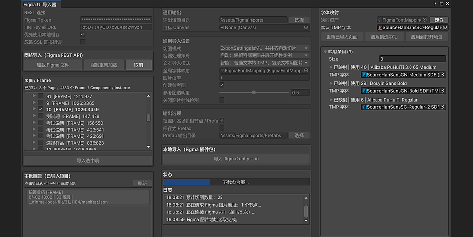
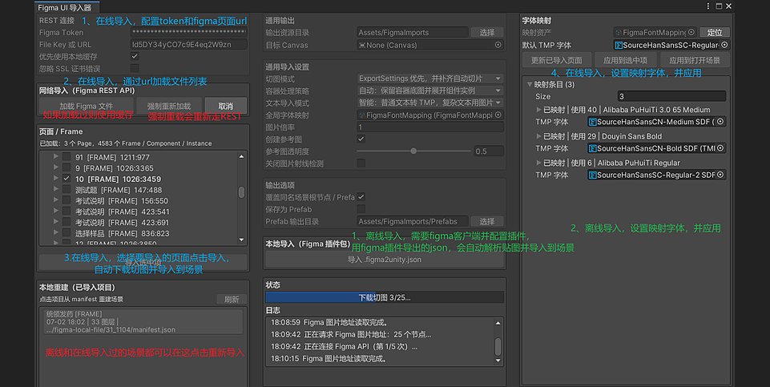

**中文** | [English](README.md)

# 🚀 Figma2Unity

将 Figma 的 Frame 导入 Unity Canvas：参考图、切图、TextMeshPro、字体映射、Manifest 和 Prefab。

> 依赖 UGUI、TextMeshPro。

## ✨ 特性

- ⭐ **两种导入方式**：Figma 插件离线包（推荐）/ Figma REST API
- 🖼️ **视觉还原**：完整参考图 + 像素校准切图，按 `clipsContent` 裁剪
- 🔤 **文本**：TMP / 图片 / 智能三种模式，保留 fallback PNG
- 🅰️ **字体映射**：单个项目级 TMP 字体映射表，自动补全条目
- 🌐 **多语言**：编辑器与 Figma 插件默认英文，可一键切换中文
- 📄 **可复现**：`manifest.json`、`diagnostics.json`、离线重建、Prefab
- 🖼️ **纹理**：自动提高 `maxTextureSize`，支持压缩 / 不压缩
- 🛡️ **安全**：未勾选覆盖时阻止重复写入已有输出目录

## 👀 预览






## 📦 安装

### Unity 包

`Window / Package Manager / + / Add package from git URL...`

- GitHub（最新）：`https://github.com/FRZ5201314/Figma2Unity.git`
- Gitee（最新）：`https://gitee.com/furanzhang/figma2unity.git`
- 固定版本：在地址后追加 `#<tag>`，例如 `#vX.Y.Z`
- 包名：`com.frz.figma2unity`

版本列表见 [GitHub Releases](https://github.com/FRZ5201314/Figma2Unity/releases) / [Gitee Releases](https://gitee.com/furanzhang/figma2unity/releases)。

### Figma 离线导出插件

从 [GitHub Releases](https://github.com/FRZ5201314/Figma2Unity/releases) 或 [Gitee Releases](https://gitee.com/furanzhang/figma2unity/releases) 下载最新的 `Figma2Unity-Offline-Exporter-v*.zip`，解压后在 Figma 中：

```text
Plugins / Development / Import plugin from manifest...
```

选择解压目录里的 `manifest.json`。从源码安装时选择本仓库的 `FigmaPlugin/manifest.json`。

**技巧**

- 如果设计师分享的 Figma 项目没有开放插件权限，可以把要导出的设计页面复制到自己的新建 Figma 项目中，再运行导出插件。
- 如果想要的图层没有正常导出，可以在 Figma 中选中该图层，手动添加为导出项，再使用 Figma 离线导出插件。

## ⚡ 快速开始

> 推荐离线包：不需要 Figma Token，不占 REST 额度，方便保存、复现和排查。

1. 在 Figma 中选中要导入的 Frame / Component / Instance。
2. 运行 `Figma2Unity Offline Exporter`，导出 `.figma2unity.json`。
3. 在 Unity 打开 `Tools/Figma2Unity`，配置输出目录、目标 Canvas 和导入选项。
4. 在“本地导入（Figma 插件包）”中点击 `导入 .figma2unity.json`，确认后导入。

输出：

```text
Assets/FigmaImports/{fileKey}/{nodeId}/
├── reference.png
├── manifest.json
├── diagnostics.json
└── layers/*.png

Canvas
└── FigmaImport_[Name]_[NodeId]
    ├── Reference/DesignReference
    └── Layers/[LayerName]
```

### REST API（可选）

`Tools/Figma2Unity` → 填写 Token 和 File Key/URL → `加载 Figma 文件` → 选择目标 → `导入选中项`。

默认使用本地缓存；需要最新设计稿时点击 `强制重新加载`。限流时可在“已导入项目”列表中用本地 manifest 重建场景。

> ⚠️ REST 图片接口无法隐藏已导出的子级，父子同时导出可能重复叠加；严格场景请使用离线包。

## 🎛 主要选项

| 选项 | 默认 | 可选 |
| --- | --- | --- |
| 切图模式 | ExportSettings + 自动补齐 | 只导入 Export 节点 / 自动切片 / 仅参考图 |
| 容器策略 | 自动 | 严格 ExportSettings / 强制展开 |
| 文本模式 | 智能 | TextMeshPro / 图片 |
| Prefab | 关闭 | 保存到 `Assets/FigmaImports/Prefabs`，文件名 `FigmaImport_[Name]_[NodeId].prefab` |
| 覆盖同名场景根节点 / Prefab | 关闭 | 开启后覆盖；关闭时同目录已有内容会中止 |

- **字体映射**：`Assets/FigmaImports/FigmaFontMapping.asset`。匹配顺序：PostScript 名称 → 字体族+样式 → 字体族+字重范围 → 字体族。
- **映射操作**：窗口可更新条目（扫描 `Assets/FigmaImports` 与当前输出目录）或应用到打开场景；未匹配使用 `DefaultFont`，且不会改写 `TMP Settings`。
- **文本转换**：选中带 `FigmaLayerBinding` 的 TEXT 节点，可在 Inspector 中切换 TMP ↔ fallback PNG。
- **诊断报告**：每次导入生成 `diagnostics.json`；REST 重叠风险写入 `warnings`。
- **参考图**：建议保留，用于切图尺寸和位置校准；关闭后仍按 PNG 尺寸导入。

## ⚠️ 已知限制

- REST 父子切图可能重复叠加，推荐使用 Figma 插件离线包。
- 未解析旋转、Mask、父级透明度和混合模式。
- 复杂/混合样式文本可能保留为 PNG；不会生成 Button、Toggle、ScrollView 等语义组件。
- 不转换 Auto Layout 为 Unity LayoutGroup，不自动生成九宫格。
- Page 可能较大，建议选择具体 Frame。

## 📌 注意

- Token 保存在 `EditorPrefs`；遇到 429 可等待额度或改用离线包。
- SSL 证书错误可在窗口临时勾选“忽略 SSL 证书错误”；仅用于受信任网络。
- 文件缓存位于 `Library/FigmaUiImporterCache`，不进入版本库。
- 覆盖模式不会清理旧 manifest 中不再引用的 PNG；需要干净目录时手动删除对应 node 目录。
- 重新导入同一目录需要勾选覆盖，或更换输出目录。
- `maxTextureSize` 最高 `8192`；大 Frame 建议先只导参考图或只导 Export 节点。

## 🧪 开发与验证

EditMode 测试位于 `Tests/Editor`，在 Unity 中通过 `Window / General / Test Runner` 运行。

覆盖范围包括：路径/manifest、切图策略、`clipsContent`、诊断报告、离线包校验、重复导入保护、字体映射与 TMP 行距/字距、TMP ↔ PNG 转换。

已验证 Unity：`2019.4.40`、`2021.3.40`。

## 📚 文档

- [设计文档](figma-to-unity-ui-importer-design.md)
- [更新日志](CHANGELOG.md)
- [Figma 离线插件说明](FigmaPlugin/README.md)

## 📜 License

MIT License © 2026 FRZ
